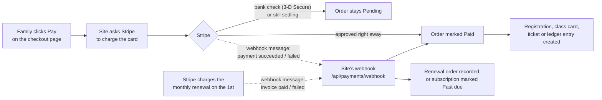

# Payments runbook

For the studio owner and Martin. It explains how online payments work, how to tell what's wrong,
and how to fix the common problems yourself using only the **Stripe Dashboard** and the **CMS**.
Only the steps marked **Developer/hosting** need access to the server.

> There is no "payment link" to break. The card form on the checkout page is Stripe's own, built
> into the site. When "payments break", one of the pieces in the diagram below has stopped
> working, and the CMS **Payment Health** screen tells you which one.

## 1. How a payment works

Two things matter:

1. **The keys.** The site talks to Stripe with secret keys stored on the server. If a key is wrong
   or was replaced in Stripe, no card can be charged.
2. **The webhook.** Stripe sends the site a message (a "webhook") whenever something happens
   later: a delayed payment finishes, or a monthly renewal is charged or declined. **Monthly
   renewals are recorded only through the webhook.** If the webhook breaks, checkout may still
   look fine, but renewals stop being recorded and some orders stay "Pending".

## 2. Where to look first

**CMS → Payment Health** (also summarized on the Dashboard). It checks Stripe live each time you
open it or press **Check again**.

| Color | Meaning |
| --- | --- |
| Green check | Working. |
| Amber | Something needs a look, but payments are going through (a past-due family, a webhook message that failed once). |
| Red | Payments or renewals are broken right now. Fix today. |

The screen lists:

- **What to look at**: each problem in plain words. The headings match the rows in section 3.
- **Setup**: whether each Stripe key works, whether Stripe has a webhook endpoint pointing at the
  site, and when the last message from Stripe arrived.
- **Orders waiting on payment for over an hour**, with the family's email and the Stripe payment
  id (starts with `pi_`).
- **Past-due subscriptions**: monthly plans whose renewal was declined.
- **Messages from Stripe**: every webhook message received, and whether it was processed, failed,
  or rejected.

To find a Stripe payment, event or subscription, paste its id (`pi_…`, `evt_…`, `sub_…`) into the
search bar at the top of the Stripe Dashboard.

## 3. Symptoms and fixes

### 3.1 Checkout shows a payment error for everyone

**Check**

1. CMS → Payment Health. Look for red items about keys:
   - *"The server cannot talk to Stripe"*: the secret key is wrong, was rolled, or was deleted.
   - *"Checkout cannot show the card form"*: the publishable key is missing.
   - *"Stripe keys are from different modes"*: one key is a test key and the other is live.
   - *"The live site is using Stripe test keys"*: real cards will be refused.
2. If Payment Health is all green, open the **Stripe Dashboard** home page and look for a red or
   yellow banner. Stripe sometimes **restricts an account** (for example, when it needs updated
   business or bank details) and refuses charges until it's resolved.

**Fix**

- Account restricted: follow the banner in the Stripe Dashboard and supply what Stripe asks for.
  Charges resume once Stripe lifts the restriction. Nothing changes on the site.
- Key problem: **Developer/hosting**. In Stripe, go to **Developers → API keys**, copy the
  **Publishable key** and the **Secret key** (use **Reveal**; if it can't be revealed, create a new
  one with **Roll key**). Put them in the API service's environment variables (section 5). On
  Render, saving the variables restarts the API. Then press **Check again** on Payment Health.
- Only one family is affected: that's a card decline, not a site problem. The family should use
  another card or call their bank. You can see the bank's reason in Stripe → **Payments** → the
  failed payment.

### 3.2 A card was charged but the order is stuck in "Pending"

This means Stripe took the money but the site never heard back, almost always because the webhook
is failing.

**Check**

1. CMS → Payment Health → **Orders waiting on payment for over an hour**. Note the payment id.
2. Stripe Dashboard → search that payment id. If it says **Succeeded**, the money was taken.
3. Payment Health → **What to look at**:
   - *"Messages from Stripe are being rejected"*: the webhook signing secret on the server doesn't
     match Stripe's. This usually happens after someone rolled the secret in Stripe.
   - *"No Stripe webhook endpoint is set up"* or *"…is disabled"*: Stripe isn't sending messages
     at all. Stripe disables an endpoint by itself after several days of failed deliveries.
   - *"The webhook endpoint is missing events"*: the endpoint exists but isn't subscribed to every
     event the site needs.
4. Stripe Dashboard → **Developers → Webhooks** (newer dashboards: **Workbench → Webhooks**, also
   called *Event destinations*) → click the endpoint ending in `/api/payments/webhook` → look at
   recent **deliveries**. Failed deliveries show the error the site returned.

**Fix**

- Signing secret mismatch: **Developer/hosting**. In the Stripe endpoint page, reveal the
  **Signing secret** (starts with `whsec_`) and set it as `STRIPE_WEBHOOK_SECRET` on the API
  service.
- Endpoint disabled: on the endpoint page, click **Enable**.
- Endpoint missing: **Add endpoint** with the URL `https://<your API address>/api/payments/webhook`
  and these events: `payment_intent.succeeded`, `payment_intent.payment_failed`, `invoice.paid`,
  `invoice.payment_failed`, `customer.subscription.updated`, `customer.subscription.deleted`.
  Then copy its new signing secret to the server as above.
- Missing events: on the endpoint page, **Update details → Select events** and add the events
  that Payment Health lists.
- Then get the lost messages delivered. Stripe retries failed deliveries by itself for up to 3
  days, so once the webhook is fixed they usually arrive on their own. To speed it up, open each
  failed delivery on the endpoint page and click **Resend**. Resending a message the site already
  handled is safe; it's ignored.
- Press **Check again** on Payment Health. The order should now be **Paid**, and its registration
  (or class card, ticket, etc.) created.

> A stuck order whose payment succeeded also gets finished automatically the next time any family
> starts a checkout, because the site re-checks old pending orders with Stripe at that moment.
> Monthly renewals don't get this backup. They depend on the webhook.

If the Stripe payment is **not** succeeded (incomplete, canceled, or requires action), the family
didn't finish paying (for example, they closed the bank's 3-D Secure window). Nothing was charged.
The order is marked failed the next time someone checks out, and the family can simply try again.

### 3.3 A monthly renewal failed / the plan is "Past due"

The family's card was declined on the 1st. Stripe retries the card automatically for a while. If
every retry fails, Stripe cancels the subscription and the dancer is withdrawn at the end of the
period already paid.

**Check**

- CMS → Payment Health → **Past-due subscriptions** (or CMS → Subscriptions, filter **Past
  due**).
- Stripe Dashboard → search the subscription id (`sub_…`) → open the latest **invoice** to see
  the decline reason and the next retry date.

**Fix: the family pays by card (preferred)**

The site has no "update my card" page, and it doesn't send email. Stripe does both for you:

1. One-time setup (owner): Stripe Dashboard → **Settings → Billing → Subscriptions and emails**
   (the heading may read *Manage failed payments* or *Revenue recovery*). Turn on **Send emails
   when card payments fail** and the link that lets customers **update their payment method**.
   Stripe sends these emails itself, at no cost, and they contain a secure link to pay with a new
   card. Smart Retries can stay on.
2. Any time, for one family: open the failed **invoice** in Stripe and copy its **payment page
   link** (the hosted invoice page). Text or email it to the family. When they pay there, Stripe
   tells the site, which records the renewal and puts the subscription back to **Active**.

**Fix: the family wants to pay cash or check instead**

Card subscriptions and the cash ledger must not overlap, or the month gets counted twice. Move
the family to pay-in-person billing:

1. CMS → **Subscriptions** → find the family's past-due plan → **Cancel subscription**. This stops Stripe from
   retrying. **It also withdraws the dancer**, who keeps access until the end of the current
   period. After that the seat is released.
2. CMS → **Front Desk** → register the same dancer in the same class with **Pay in person**.
   From then on, a tuition charge is posted to the family's account on the 1st of each month.
3. Record the cash or check payment against that charge (Front Desk payment step, or CMS →
   **Accounts** → find the family → **Record payment**).
4. In Stripe, leave the old failed invoice alone. Canceling the subscription closes it out. **Don't**
   use *Mark as paid* on it, which would record the month a second time.

> If the Front Desk says the class is full at step 2, the dancer's old seat is still held until
> the end of the period. Contact the developer rather than overriding the capacity.

### 3.4 A family says they paid, but there's no registration

**Check**

1. Stripe Dashboard → **Payments** → search the family's email. Is there a **Succeeded** payment
   for that amount and day? If not, they weren't charged (often a declined card or an abandoned
   3-D Secure check). Ask them to try again.
2. If there is one, open it. Its **metadata** shows `orderId`. The last 8 characters, in capitals,
   are the order number the CMS shows (`#A1B2C3D4`).
3. CMS → **Orders** → set **From/To** to the day of the payment → find the family's name → **View**.
   The status history shows what happened:
   - **Pending**: see 3.2.
   - **Paid** with a warning icon ("Needs attention"): the payment worked, but a later step (for
     example, creating the registration) failed. The order lists what failed. Send the order
     number to the developer.
   - **Paid** with no warning: the registration exists. Check CMS → Users → the family's
     **Class registrations** button (student icon). It may be under a different student.

### 3.5 Refunds

The site never moves money back by itself. A refund takes two steps:

1. **Stripe Dashboard** → find the payment → **Refund** (full or partial). This returns the money
   to the card.
2. **CMS → Orders** → the order → set status **Refunded** (add a note). This updates the family's
   account balance and cancels a class card bought on that order.

Marking an order refunded does **not** withdraw a dancer or stop a monthly plan. Do those
separately: CMS → Subscriptions → **Cancel subscription** for the monthly plan, and CMS → Users →
the family's **Class registrations** → **Withdraw** for the class.

A refund made only in Stripe doesn't show up in the CMS, and the reverse is also true. Always do
both steps.

## 4. Who owns what

| What | Who | Notes |
| --- | --- | --- |
| Stripe account login | Owner | Can invite Martin under Stripe → **Settings → Team** (the *Developer* or *Administrator* role lets him follow this runbook). |
| Stripe settings: webhook endpoint, failed-payment emails, refunds | Owner or Martin | Everything in section 3 that happens in the Stripe Dashboard. |
| CMS Payment Health, Orders, Subscriptions, Front Desk, Accounts | Owner and staff with order access | Payment Health needs the same permission as Orders. |
| Environment variables and hosting (Render, API service) | Martin or the developer | Needed only when a key or the signing secret changes. |
| Code, database, failed "Needs attention" steps | Developer | See below. |

**Escalate to the developer when:**

- Payment Health stays red after you've followed the matching fix.
- A message in **Messages from Stripe** stays **Failed** after Stripe's retries or a manual
  Resend. Its error text tells the developer what broke.
- An order shows **Needs attention**.
- Payment Health itself won't load.

## 5. Payment environment variables

All four live on the **API** service (on Render: the API service → **Environment**), **not** on
the web service. Values are never written down here. Get them from the Stripe Dashboard when needed.

| Variable | Required | What it is | Where it comes from |
| --- | --- | --- | --- |
| `STRIPE_SECRET_KEY` | Yes | Lets the server charge cards. Starts with `sk_live_` (real) or `sk_test_` (test). | Stripe → Developers → API keys → Secret key |
| `STRIPE_PUBLISHABLE_KEY` | Yes | Lets the checkout page show Stripe's card form. Starts with `pk_live_` / `pk_test_`. Must be the same mode as the secret key. | Stripe → Developers → API keys → Publishable key |
| `STRIPE_WEBHOOK_SECRET` | Yes | Proves webhook messages really come from Stripe. Starts with `whsec_`. Each endpoint has its own. | Stripe → Developers → Webhooks → the endpoint → Signing secret |
| `STRIPE_TAX_ENABLED` | No | Set to `false` to turn sales tax off everywhere. Leave unset to collect tax with Stripe Tax. | Your choice |

After changing any of them, the API restarts. Open Payment Health and press **Check again** to
confirm.
